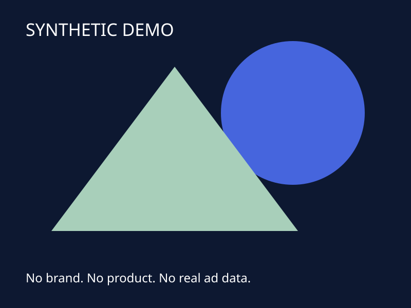

# AEPI13-Zaku

**广告素材、数据和决策过程放在一起的自托管复盘工作台。当前是半成品／公开预览版。**



这不是自动投放系统，也不承诺提高转化率。它尝试保留一条可学习的链路：

**看素材 → 理解设置 → 看当时数据 → 记录为什么建议调整 → 回查实际执行与结果。**

仓库不含真实品牌、商品、广告账户、经营数据、数据库备份、凭据、生产截图或生产网络配置。所有示例均为手工构造的虚构数据。

## 当前提供什么

- Meta 数据读取、历史分页归档、素材预览与广告级指标关联。
- PostgreSQL 学习时间线：事实、假设、建议、批准、实际执行、验证结果分开记录，追加版本而非覆盖。
- 本地素材文件校验、图片预览和视频 Range 读取模块。
- 服务器规则复盘与重复记录恢复模块；**没有接入AI模型**。
- 受控素材下载和备份 Worker 源码。Worker 的队列接入、NAS挂载及调度仍需按自己的环境配置。
- Google 适配器源码和历史报表接口；公开预览版不附授权，也未在新安装环境完成端到端验证。

## 先运行演示

需要 Node.js 24、Docker Engine 与 Docker Compose。下面命令只在自己的机器创建新数据，不连接任何广告账户。

```sh
git clone https://github.com/zhang3phone/aepi13-zaku.git
cd aepi13-zaku
npm run setup
docker compose --env-file .env.local up -d --build
```

打开 <http://localhost:8098>。用户名 `admin`，随机密码在本机 `.local-login.txt`，不要上传该文件。

默认 `DEMO_MODE=true`，示例日期为 **2026-10-01**；查看素材指标时选择这个日期。其他日期无示例结果不代表零。演示数据只用于理解界面，不能用作真实效果证据。

```sh
npm ci
npm test
npm run privacy:check
```

Docker Compose 默认仅绑定本机回环地址，数据库不发布端口。数据库和素材使用独立命名卷。请勿在不理解后果时执行删除卷的命令。

## 连接自己的平台数据

先完成演示，再阅读 [部署说明](docs/DEPLOYMENT.md)。Meta 只读适配器默认不下载，需要显式安装；Google 需要独立配置。切换真实模式时使用**新的空数据库和存储卷**，不要把演示与真实记录混在一起。

平台历史保留、权限和账户状态决定可读取范围。本项目不能恢复平台已经删除的数据。归因购买不是商店去重付款订单；广告级指标也不能当作每张素材的独立效果。

## 每日复盘

模块支持昨日与测试周期累计、缺失不补零、按广告与日期去重及失败恢复。公开版默认不安装定时器、不启动 Worker，也不调用任何模型。配置和验收步骤见部署说明；当前规则主要按美元、太平洋时区设计，其他口径仍待适配。

优化建议不会修改预算、受众、素材，不会发布、暂停或重启广告。后台的“建议”“已批准”“已执行”“验证结果”是不同状态，不能混用。

## 半成品边界

目前主要是单人自用架构。多租户权限、会话持久化、完整告警、跨平台归因、商店订单对账、利润模型、素材变更历史、自动化安装和更完整的恢复演练都需要继续完善。部分服务故障仍需人工介入。

生产环境曾验证过的功能，不代表每个新环境都已经验证。本公开版本将分别记录实际完成的测试和未覆盖的组合。它适合学习、试用和二次开发，不适合未经审核直接接管生产。

本仓库采用 MIT；第三方依赖保留各自许可证，见 [第三方说明](THIRD_PARTY_NOTICES.md)。
